<div align="center">
  
  <br/>
  <h1>Logistics for Social Good.</h1>
  <p><i>Bridging the gap between urban surplus and critical need through AI-driven logistics.</i></p>

  [](https://nextjs.org/)
  [](https://fastapi.tiangolo.com/)
  [](https://supabase.com/)
</div>

---

## 🎯 The Problem
Humanity does not have a scarcity problem; it has a **distribution problem**. 
- **1.05 Billion Tonnes** of food is wasted globally every year while 783 million people face hunger.
- **92 Million Tonnes** of textile waste are generated annually due to the fast fashion epidemic.
- **Emergency Relief** is often chaotic, with camps receiving unneeded goods instead of essential supplies.

The root cause is a failure of last-mile logistics. Surplus exists, and need exists, but they are disconnected.

## 💡 The Solution: Sahyog
Sahyog is a **Reverse E-commerce and Hyper-Local Logistics Platform**. It acts as an operating system for social good, connecting Donors, Vendors, NGOs, and Delivery Drivers in one unified ecosystem. 

Instead of blindly dropping off old clothes, users browse a "Needs Board" and fulfill specific, real-time requests—making charity as seamless as ordering food on Blinkit or Zepto.

### 🌟 Core Features
*   🛒 **Reverse E-commerce Storefront:** NGOs post exactly what they need. Donors browse and add items to their cart, ensuring zero wasted donations.
*   🏪 **Sahyog Express (Vendor Terminal):** Partnered grocery stores get a dedicated dashboard to manage inventory (stock, mfg/expiry dates). Donors can directly purchase goods for NGOs, which Sahyog routes for delivery.
*   🚚 **Uber-Style Live Tracking:** Real-time GPS tracking of delivery partners using Leaflet, OSRM, and Supabase Realtime. Includes multi-stop route optimization via Google OR-Tools.
*   🧠 **FreshGuard™ AI:** A Vision AI agent that scans uploaded donor photos to verify food freshness and textile quality, rejecting unsafe items instantly.
*   🔐 **Double-OTP Security:** A strict chain-of-custody protocol requiring a pickup OTP from the donor/vendor and a drop-off OTP from the NGO.

## 🏢 The 4 Role-Based Dashboards
1.  **Donor POV:** E-commerce style shopping, cart, impact tracking (Punya Meter), and live delivery tracking.
2.  **NGO POV:** "Pantry AI" inventory tracker, wishlist creator, and an inbox to accept/decline incoming donations.
3.  **Vendor POV (Shop Owner):** Inventory management, expiry alerts, and dual options to Sell or Donate surplus.
4.  **Driver POV:** Uber-style dispatch feed, optimized multi-stop map, and a Barter Rewards Wallet (earning free meals for deliveries).

## 🛠 Tech Stack
*   **Frontend:** Next.js 14 (App Router), Tailwind CSS, Framer Motion, React Leaflet, Recharts.
*   **Backend:** FastAPI (Python), Google OR-Tools (Routing), OSRM (Distance Matrix).
*   **Database & Auth:** Supabase (PostgreSQL, Row Level Security, Realtime, Storage).
*   **AI & Emails:** OpenRouter (LLM), Resend (SMTP).

## 🚀 Getting Started (Local Setup)

### Prerequisites
- Node.js & npm
- Python 3.10+
- Supabase Account

### 1. Clone the repository
```bash
git clone https://github.com/sahyoglogistics01-ui/Sahyog.git
cd Sahyog
